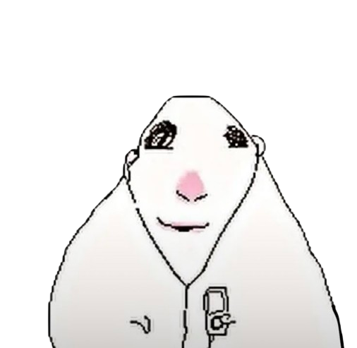

# HampterDesk
A tiny meme-influenced desktop pet that lives on your screen.Hampter uses sensors and timers to make the interactions more funny and real.

Some pictures of hampter

demo screenshot and screen records

[demo.webm](https://github.com/user-attachments/assets/89832969-2d5a-4488-8c08-036e9f3c517f)

FEATURES

Draggable: move hampter anywhere on your screen and interact

Transparent background:transparent pet that sits above your
screen so it doesnt cover anything

Reacts to typing: hampter notices keyboard activity and reacts

Idle bobbing: hampter gently bounces up and down to feel more alive

interactions: hampter smiles when you click and and gets sad when you
dont for a long time

Mood swings: hampter uses a timer and reacts randmoly when you dont
interact for a long time

Built with
Python
Pyside6
PiInstaller

How to download

from link
https://github.com/elinaa09/HampterDesk/releases/tag/v1.0

for windows: download "HampterDesk-windows.exe" then double click to run

for linux: download main
run with: chmod +x main
           ./main
